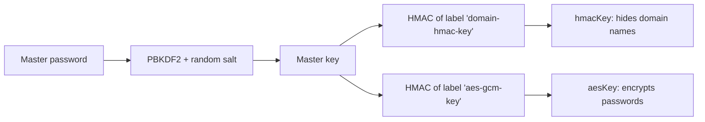
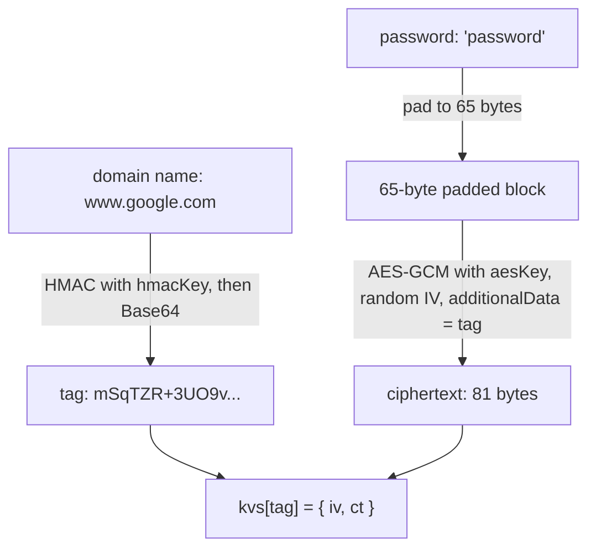
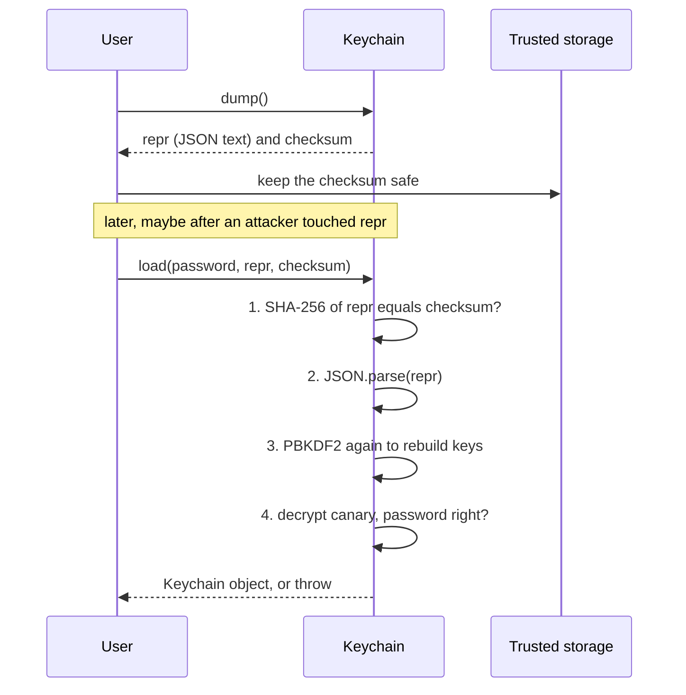
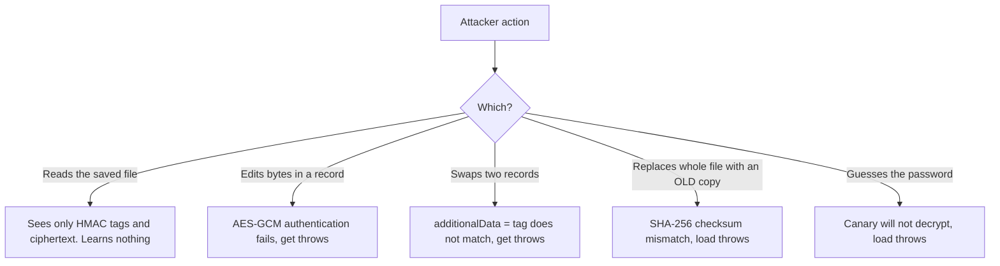

# Secure Password Manager

**Course:** ICS 3201 Computer Security
**Files covered:** `password-manager.js` (the graded file), `demo.js` (the presentation script), `lib.js` (helpers)

> **How to view the diagrams:** the flow charts below are written in Mermaid.
> They render automatically on GitHub, and in VS Code if you install the
> extension **"Markdown Preview Mermaid Support"**, then press `Ctrl+Shift+V`.
> Every diagram also has a plain-text version, so nothing is lost if they don't render.

---

## Table of contents

1. [The story: the school lunchbox locker room](#1-the-story-the-school-lunchbox-locker-room)
2. [The theory flow you need to know first](#2-the-theory-flow-you-need-to-know-first)
3. [Mini glossary](#3-mini-glossary)
4. [`password-manager.js` block by block](#4-password-managerjs-block-by-block)
5. [`demo.js` block by block](#5-demojs-block-by-block)
6. [Attack and defense cheat-sheet](#6-attack-and-defense-cheat-sheet)
7. [Short-answer questions](#7-short-answer-questions)
8. [Conclusion: what we did, what we noticed, pros and cons](#8-conclusion)
9. [Things to say out loud when presenting](#9-things-to-say-out-loud-when-presenting)
10. [Running and testing](#10-running-and-testing)
11. [References](#11-references)

---

## 1. The story: the school lunchbox locker room

Imagine a school with a **locker room full of lunchboxes**. You want to keep your lunch safe from a sneaky classmate who has the **full floor plan** of the room (the attacker can read our source code and the saved file).

- Your **locker key** is the **master password**.
- A **slow locksmith** makes your real key from your password. He takes ten seconds per attempt, so a thief guessing passwords is stuck waiting (**PBKDF2**).
- A **random sticker** on your locker makes two students with the same password end up with different locks (**salt**).
- You get **two keys** made from the master key: one **relabels lockers**, one **locks lunchboxes** (**hmacKey** and **aesKey**).
- Lockers are numbered with **scrambled codes**, never names like "Amani's locker" (**HMAC tags** instead of domain names).
- Every lunchbox is the **same size**, with filler, so nobody can tell a big lunch from a small one (**padding**).
- Each lunchbox has **its own locker number printed inside the lid**. If a box is moved to another locker, the number inside doesn't match and the lock refuses to open (**AES-GCM additionalData**, the swap defense).
- A **test sandwich** is sealed in every set of lockers. Only the right key opens it, so we know you typed the right password (**the canary**).
- A **receipt in your pocket** holds a "photo" of the whole locker room. If someone puts an old locker room back, the photo no longer matches (**SHA-256 checksum**, the rollback defense).

### Analogy map

| In the story | In the lab | In the code |
|---|---|---|
| Locker key | Master password | the `password` argument |
| Slow locksmith | PBKDF2 | `deriveKeys()` |
| Random sticker | Salt | `getRandomBytes(16)` |
| Relabeling key | HMAC key | `hmacKey` |
| Lunchbox lock | AES-GCM key | `aesKey` |
| Scrambled locker codes | HMAC tags | `tag` (the key in `kvs`) |
| Same-size lunchboxes | Padding | `padValue()` / `unpadValue()` |
| Locker number inside the lid | AES-GCM `additionalData` | `additionalData: stringToBuffer(tag)` |
| Test sandwich | Canary | `makeCanary()` / `parsed.check` |
| Photo of the room | SHA-256 checksum | second item returned by `dump()` |
| Pocket receipt | Trusted storage | where *you* keep the checksum |

---

## 2. The theory flow you need to know first

### 2.1 The big picture



Plain-text version:

```
master password + salt
        |
     PBKDF2   (slow on purpose, called ONCE)
        |
   master key
     /      \
HMAC("domain-hmac-key")   HMAC("aes-gcm-key")
     |                         |
  hmacKey                    aesKey
 (hide domain names)    (encrypt passwords)
```

**Why two keys?** A key should do one job only. If one key leaked or was misused, the other would stay safe. HMAC works here as a *pseudorandom function*: giving it two different labels produces two keys that look unrelated.

### 2.2 What one stored record looks like



Plain-text version:

```
name  --HMAC(hmacKey)-->  tag  ---------------------------+
                                                           v
password --pad to 65 bytes--> AES-GCM(aesKey, iv, AAD=tag) --> { iv, ct }
                                                           |
                                          kvs[tag] = { iv, ct }
```

**Where does 81 bytes come from?** 65 padded bytes + 16 bytes for the AES-GCM authentication tag = 81 bytes, for every password of any length.

### 2.3 The saved file (the `dump()` result)

```
{
  "salt":  "random sticker, public",
  "check": { "iv": "...", "ct": "..." },     <- the canary (test sandwich)
  "kvs":   { "<tag1>": {iv, ct}, "<tag2>": {iv, ct}, ... }
}
```

**Never inside:** the master password, any hash of it, `hmacKey`, `aesKey`.

### 2.4 `dump` then `load`



### 2.5 Which defense catches which attack



---

## 3. Mini glossary

| Term | Kid-friendly meaning | Real meaning |
|---|---|---|
| **Salt** | Random sticker | Random public bytes mixed into key derivation so identical passwords give different keys |
| **PBKDF2** | Slow locksmith | A deliberately slow key-derivation function that rate-limits guessing |
| **HMAC** | A secret stamp | A keyed hash. Same key + same input always gives the same output (deterministic) |
| **PRF** | Key-making machine | A function that looks random. We use HMAC to make two sub-keys |
| **AES-GCM** | A lock that also notices tampering | Authenticated encryption: gives confidentiality *and* integrity |
| **IV (nonce)** | A fresh random twist for each lock | 12 random bytes. Must **never repeat** with the same key |
| **AAD / additionalData** | A note sealed in the lid, not hidden but protected | Data that is *authenticated but not encrypted*. Changing it breaks decryption |
| **SHA-256** | The photo | A fingerprint of data. Any change gives a totally different result |
| **Base64** | Turning bytes into letters | A text form of binary data that fits in JSON and object keys |
| **Canary** | Test sandwich | A known text we encrypt to check that the password is right |
| **Rollback attack** | Putting an old box back | Replacing current data with an older but valid version |
| **Swap attack** | Switching two labels | Interchanging the records of two keys |

---

## 4. `password-manager.js` block by block

### 4.1 Header comment
The comment at the very top is the whole design in a few lines: master password → PBKDF2 → two sub-keys, padding, labels tied to boxes, and a checksum. It exists to help a reader (or your lecturer) understand the design before reading any code.

### 4.2 `"use strict";`
Turns on JavaScript strict mode. It catches silly mistakes (like using an undeclared variable) by throwing an error instead of silently continuing.

### 4.3 Imports
```js
const { stringToBuffer, bufferToString, encodeBuffer, decodeBuffer, getRandomBytes } = require("./lib");
const { subtle } = require("crypto").webcrypto;
```
- The first line loads the **five helper functions** from `lib.js`: text↔bytes, bytes↔Base64, and random bytes.
- The second line gets `subtle`, Node's built-in **SubtleCrypto**. We never write our own crypto; we only use this trusted library.

### 4.4 Constants
| Constant | Value | Purpose |
|---|---|---|
| `PBKDF2_ITERATIONS` | 100000 | How many rounds PBKDF2 repeats. More = slower for attackers |
| `MAX_PASSWORD_LENGTH` | 64 | The spec's maximum password size |
| `PADDED_SIZE` | 65 | 1 length byte + 64 data bytes. Every plaintext becomes exactly this size |
| `CANARY_TEXT` | `"keychain-password-check"` | The known sentence we encrypt to verify the password |

### 4.5 `deriveKeys(password, salt)`: the key factory
It returns `{ hmacKey, aesKey }` and calls PBKDF2 **exactly once** (a spec requirement).

| Step | Code idea | What it does |
|---|---|---|
| 1 | `subtle.importKey("raw", ..., "PBKDF2", false, ["deriveKey"])` | Wraps the password's bytes into a `CryptoKey` that may *only* be used to derive keys |
| 2 | `subtle.deriveKey({ name: "PBKDF2", salt, iterations, hash: "SHA-256" }, ...)` | **The slow call.** Password + salt become a 256-bit master key, built as an HMAC key |
| 3 | `subtle.sign("HMAC", master, "domain-hmac-key")` and the same with `"aes-gcm-key"` | Uses HMAC as a PRF. Two different labels give two independent random byte strings |
| 4 | `subtle.importKey("raw", bits, ...)` twice | Turns each byte string into a proper key limited to one job: `hmacKey` can only **sign**, `aesKey` can only **encrypt/decrypt**. The `false` means the keys can't be exported |

### 4.6 `makeCanary(aesKey)`: the test sandwich
1. `getRandomBytes(12)` creates a fresh random IV.
2. `subtle.encrypt(AES-GCM, ...)` encrypts `CANARY_TEXT`, with `additionalData: "canary"` as a label.
3. It returns `{ iv, ct }` in Base64, so JSON can store it.

On `load()`, decrypting this successfully proves the password was right. A wrong password gives a different key, so AES-GCM's authentication fails and `decrypt` throws. Nothing about the password is stored, and it works even on an empty keychain.

### 4.7 `padValue(value)` and `unpadValue(buffer)`: hiding length
**`padValue`**
1. Converts the password to bytes.
2. Throws if it is longer than 64 bytes.
3. Creates a 65-byte array of zeros.
4. Writes the real length into byte 0.
5. Copies the password bytes after it. The rest stays zero.

**`unpadValue`** reads byte 0 to learn the real length, then returns only that many bytes as a string.

Layout: `[ length ][ password bytes ][ zero filler ]`, always **65 bytes**.

### 4.8 `class Keychain`
Holds two things:
- `this.data` is the **public** part (`salt`, `check`, `kvs`). It is safe to write to disk.
- `this.secrets` is the **private** part (`hmacKey`, `aesKey`). It stays in memory and is never written out.

#### `constructor(data, secrets)`
Just stores the two parts. Outsiders use `init` or `load`, never the constructor.

#### `static async init(password)`: new empty keychain
1. Make a 16-byte (128-bit) random **salt**.
2. `deriveKeys(password, salt)` gives the two keys.
3. `makeCanary(aesKey)` gives the password check.
4. Return a new `Keychain` with `{ salt, check, kvs: {} }` and the keys.

#### `static async load(password, repr, trustedDataCheck)`: open a saved keychain
| Step | What happens |
|---|---|
| 1. Rollback check | **Only if** a checksum was given: SHA-256 the exact `repr` string and compare it with the trusted checksum. Mismatch → `throw` |
| 2. Parse | `JSON.parse(repr)` turns the text back into an object |
| 3. Rebuild keys | `deriveKeys(password, salt)` with the stored salt (the only PBKDF2 call here) |
| 4. Password check | Decrypt the canary inside `try/catch`. Failure → `throw "Invalid password (or corrupted data)"` |
| 5. Double-check | The decrypted text must equal `CANARY_TEXT`, otherwise `throw` |
| 6. Rebuild | Return a new `Keychain` using the **parsed** `kvs` (so any edits to it are reflected) and the new keys |

#### `async dump()`: save the keychain
1. Builds `publicState = { salt, check, kvs }` **by hand**. We never `JSON.stringify(this)`, because that would also write the keys.
2. `JSON.stringify(publicState)` makes the text `repr`.
3. `subtle.digest("SHA-256", repr)` computes the checksum of that **exact** string.
4. Returns `[repr, checksumBase64]`.

#### `async set(name, value)`: add or update
1. **Hide the domain:** `tag = Base64(HMAC(hmacKey, name))`.
2. **Hide the length:** `padded = padValue(value)`.
3. **Encrypt:** fresh random IV, AES-GCM with `additionalData = tag` (the **swap defense**).
4. **Store:** `kvs[tag] = { iv, ct }`. A new `tag` adds an entry; an existing `tag` is overwritten (update).

#### `async get(name)`: read
1. Compute the same `tag`.
2. If `kvs[tag]` doesn't exist → return `null`.
3. Decrypt using the same `additionalData = tag`.
4. If decrypt fails (modified or **swapped** record) → `throw "Tampering detected"`.
5. Otherwise `unpadValue(...)` and return the real password.

#### `async remove(name)`: delete
Computes the tag. If it isn't in `kvs`, return `false`. Otherwise `delete` it and return `true`.

### 4.9 `module.exports = { Keychain }`
Makes the class available to other files (`demo.js` and the course tests).

---

## 5. `demo.js` block by block

This file is for presenting. It is **not** submitted.

| Block | What it does |
|---|---|
| Imports | Loads `Keychain` and `decodeBuffer` (used to measure ciphertext sizes) |
| `line`, `title`, `ok`, `info` | Tiny print helpers that make the output tidy |
| `expectThrow(fn)` | Runs a function. Returns the error text if it threw, or `null` if it didn't. Used to *prove an attack was caught* |
| `(async () => { ... })()` | An async function that runs immediately, because `await` needs to be inside one |
| `MASTER` | The demo master password |
| **Section 1** | Creates a keychain with `init`, stores four sites with `set` |
| **Section 2** | Shows `get` (found and missing → `null`), an update, and `remove` returning `true` then `false` |
| **Section 3** | Runs `dump()`, prints the first lines of the JSON, and **searches the dump** for any domain, password, or master password. None should appear |
| **Section 4** | `load()` with the right password works. With a wrong password it throws |
| **Section 5** | Stores a 1-character and a 64-character password. Compares ciphertext sizes (81 bytes each) to prove **length hiding** |
| **Section 6** | **Swap attack:** swaps two records in the JSON, loads **without** a checksum, then `get` throws. Proves the swap defense works independently |
| **Section 7** | **Rollback attack:** saves an old dump, updates the password, then loads the old dump with the new trusted checksum. `load` throws |
| **Section 8** | **Bit-flip tampering:** flips one bit in one ciphertext. Exactly one record fails to decrypt. Proves AES-GCM integrity |

---

## 6. Attack and defense cheat-sheet

| Attack | What the attacker does | Defense | Where in code |
|---|---|---|---|
| Read the file | Looks at the dump | HMAC tags + AES-GCM | `set`, `dump` |
| Learn password length | Compares ciphertext sizes | Padding to 65 bytes | `padValue` |
| Guess the master password | Tries many passwords | PBKDF2 (slow) + salt | `deriveKeys` |
| Wrong password at load | Types any password | Canary won't decrypt | `makeCanary`, `load` |
| Modify a record | Changes bytes | AES-GCM authentication | `get` |
| **Swap** two records | Interchanges entries | `additionalData` = tag | `set`, `get` |
| **Rollback** | Restores an old database | SHA-256 checksum in trusted storage | `dump`, `load` |

**Key point:** the swap defense and the rollback defense are *independent*. Swap protection works even when no checksum is given.

---

## 7. Short-answer questions

1. **Hiding password lengths:** every password is padded to a fixed 65 bytes (1 length byte + 64 data bytes) before encryption, so every ciphertext has the same length.
2. **Swap attacks:** each record's HMAC tag is passed to AES-GCM as `additionalData`. Decryption only succeeds with the same tag, so a record moved under a different tag fails authentication and `get` throws. This needs no checksum.
3. **Is trusted storage necessary for rollback defense?** Yes. An attacker could replace the whole database, plus any hash stored beside it, with an older but valid pair. Only a value the attacker cannot modify (a checksum or counter in trusted storage) lets us notice.
4. **Randomized MAC instead of HMAC:** the tag can't be recomputed from the name, so lookup would need to verify the name against **every** stored tag. That makes lookup **O(n)** instead of O(1).
5. **Hiding the record count:** pad the store with dummy records (random tag, IV and ciphertext of the right size) up to the next power of two, so only about log₂(k) is leaked. New real records replace dummies, and the real count is kept in an encrypted record.
6. **Multi-user sharing:** use a separate random key for the shared site. Encrypt that site's record under it, and give each user a copy of that key encrypted under their own master key. The other sites stay under individual keys.

---

## 8. Conclusion

### What we did
We built a small password-manager core: a keychain that derives two keys from a master password, hides domain names, hides password lengths, encrypts every record on its own, and can be saved to a string and loaded back. It detects wrong passwords, edited records, swapped records, and (with a trusted checksum) rolled-back databases.

### What we observed and learned

1. **Encryption is not enough.** AES-GCM hides data and detects *modification*, but it can't tell that a perfectly valid record is **old** (rollback) or sits in the **wrong place** unless we add more: the checksum and the `additionalData` binding.
2. **`additionalData` is a very cheap defense.** One extra argument gives swap protection with no extra storage.
3. **Deterministic labels are a trade-off.** HMAC gives O(1) lookup, but the same domain always gives the same tag, so an attacker can see *which* record changed between two dumps.
4. **Authentication failures are indistinguishable.** A wrong password and a corrupted file both look like "decrypt failed". That is intentional, because it gives the attacker less to learn from.
5. **Never serialize the whole object.** `JSON.stringify(this)` would have written the keys to disk. Building the public state by hand avoids this.
6. **Padding costs very little but hides a lot.** Every record is 81 bytes instead of 17 to 81, which is a tiny price for hiding length.
7. **Small typos matter.** Most of our bugs were spelling and wiring errors, not cryptography errors.

### Pros

- Uses only a standard, trusted crypto library. No home-made crypto.
- Confidentiality **and** integrity per record (AES-GCM).
- Domain names and password lengths are hidden.
- No password, password hash, or key is stored in the file.
- Swap and rollback defenses work **independently**.
- O(1) `get`, `set`, `remove`; O(n) only for `dump` and `load`.
- Each record is encrypted on its own, so reading one doesn't decrypt the rest.

### Cons and limitations

- **Rollback and deletion** are only detected if the user supplies the checksum. Without it, an attacker can restore an old file or delete records, and nothing complains.
- **The checksum needs trusted storage**, which the program can't provide itself.
- **The number of records leaks** (Question 5 describes a fix).
- **Deterministic tags** reveal when the same domain is updated across dumps.
- **100,000 PBKDF2 iterations** is lower than today's recommendations, and faster than the 0.5 to 1 second the spec mentions on a laptop. A real product would raise it.
- **Passwords are limited to 64 bytes.** Non-ASCII characters use several bytes each.
- **Secrets stay in memory** until JavaScript's garbage collector frees them. We can't reliably wipe them.
- **No master-password change.** A real product needs re-encrypting everything under a new key.
- **No multi-user support** or interactive front end, which the assignment doesn't ask for.
- **Errors are thrown as plain strings**, which is fine for this assignment but not good practice in production.

> As the assignment says: this project is **not** a substitute for a real password manager.

---

## 9. Things to say out loud when presenting

- "Everything starts from one master password. PBKDF2 turns it into a master key, and HMAC splits that into two keys, one for labels and one for locks."
- "Domain names are never stored. The key in the database is an HMAC of the name."
- "Every password is padded to 65 bytes, so all records look the same size."
- "`dump` builds the public data by hand so the keys are never written out."
- "The checksum is a SHA-256 of the exact JSON string. If an old file is put back, it doesn't match."
- "The canary lets us check the password without storing anything about it."
- "Swap protection comes from putting the tag in AES-GCM's `additionalData`, so it works even without the checksum."
- "`load` calls PBKDF2 only once."

---

## 10. Running and testing

**Run the demo (from the folder with the three files):**
```bash
node --version      # needs v18 or higher
node demo.js
```
Expect eight sections, each ending in `[PASS]`.

**Run the course tests (from the starter's `proj1` folder):**
```bash
# copy your finished password-manager.js into this folder first
npm install
npm test
```

**If you see `mocha: Permission denied`:**
```bash
chmod +x node_modules/mocha/bin/*
chmod -R +x node_modules/.bin
npm test
# or run it directly:
node node_modules/mocha/bin/mocha.js
```
(The `EBADENGINE` warnings and the `npm audit` vulnerability messages during `npm install` are harmless for this assignment.)

**Extra manual checks:**
1. Dump a keychain, change one character of the JSON, and load it **with** the checksum. It should throw.
2. Dump, swap two values in `kvs`, load **without** a checksum, then `get`. It should throw.
3. Load with the wrong password, with and without a checksum. It should throw.

---

## 11. References

- MDN, SubtleCrypto: https://developer.mozilla.org/en-US/docs/Web/API/SubtleCrypto
- Wikipedia, PBKDF2: https://en.wikipedia.org/wiki/PBKDF2
- Wikipedia, HMAC: https://en.wikipedia.org/wiki/HMAC
- Wikipedia, Galois/Counter Mode: https://en.wikipedia.org/wiki/Galois/Counter_Mode
- Wikipedia, SHA-2: https://en.wikipedia.org/wiki/SHA-2
- Wikipedia, Salt (cryptography): https://en.wikipedia.org/wiki/Salt_(cryptography)